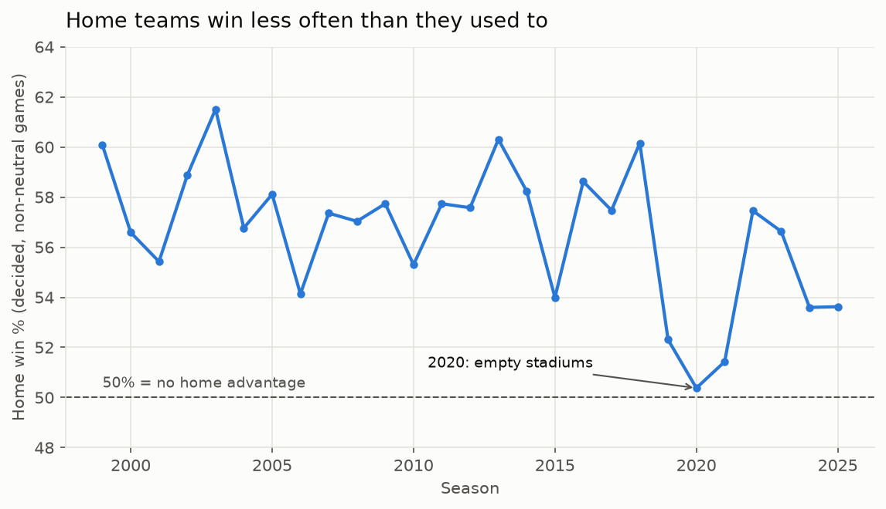
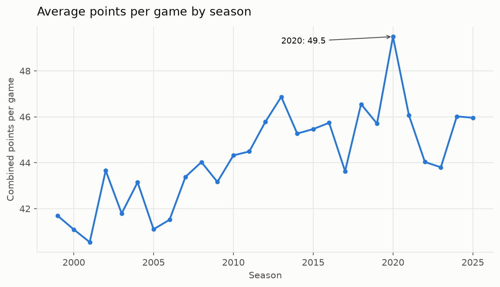
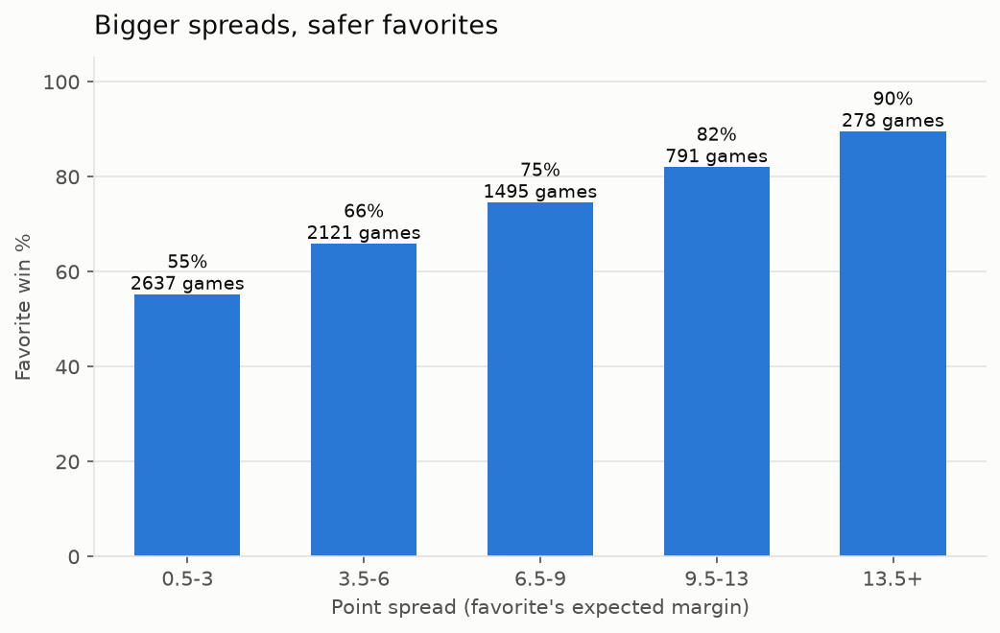
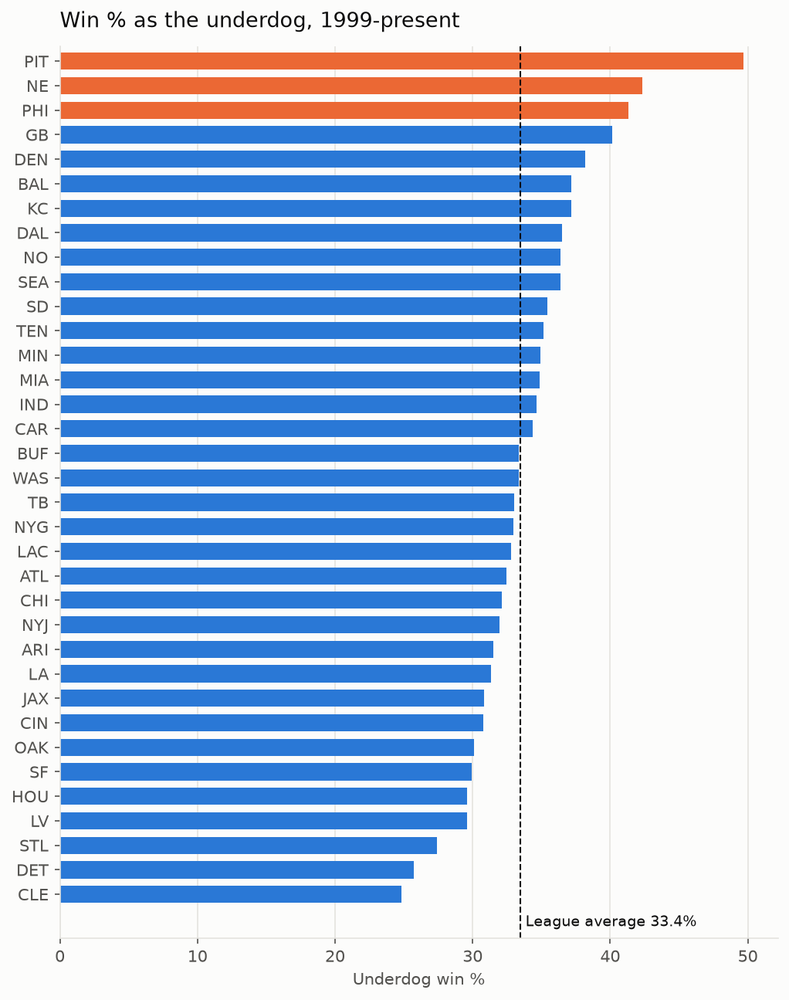

# NFL Game Predictor

Predicting NFL game winners with Python, pandas and scikit-learn, using [nflverse](https://github.com/nflverse) game data from 1999 to today.

The project is built in four stages, one git commit each: plain-Python exploration, pandas analysis, charts plus leakage-safe features, and a logistic regression model compared against two baselines.

## Results

Trained on the 2018–2024 regular seasons, tested on the **2025 regular season** (271 games, ties excluded):

| Method | Correct | Accuracy |
|---|---|---|
| Always pick the home team | 146/271 | 53.9% |
| **Logistic regression (this project)** | **161/271** | **59.4%** |
| Vegas favorite (point spread) | 177/271 | 65.3% |

The model beats the home-team baseline using five pre-game features: recent points scored and allowed, season win % to date, rest difference, and whether it's a divisional game. It doesn't beat Vegas, which is expected, because betting lines include injuries, quarterback news and market information this model doesn't see. With 271 test games the margin of error is about ±6 points, so testing on more seasons is the next step. Full output, including coefficients, is in [results.md](results.md).

## Findings

**Home-field advantage has shrunk.** Home teams won 57.7% of decided games in 1999–2014 and 55.1% in 2015–2025. In 2020, with no fans, it was 50.4%.



**Scoring rose for two decades**, peaking at 49.5 points per game in 2020.



**The point spread is well calibrated.** Favorites of 3 points or fewer win 55% of the time, while favorites of 13.5+ points win 90%.



**Underdogs win a third of the time (33.4%)**. Pittsburgh wins almost half its games as an underdog.



## How it avoids data leakage

Every feature for a game is computed only from games played **before** it (`shift(1)` before each rolling window), and the train/test split is by season, not random. `tests/test_features.py` proves this: it scrambles all scores after a cutoff date and checks that no feature on or before that date changes. It also cross-checks 150 games against a brute-force recomputation. Deleting the `shift(1)` makes the test fail, as it should.

One data detail worth knowing: in nflverse, `spread_line` is the **home team's expected margin** (positive = home favored), the opposite of sportsbook notation. I verified this against known Super Bowl lines and the moneylines before using it.

## How to run

Requires Python 3. Stage 1 uses only the standard library. The rest needs a virtual environment:

```sh
python3 -m venv .venv            # create the environment (once)
source .venv/bin/activate        # activate it (every new terminal)
pip install -r requirements.txt  # install dependencies (once)
```

Run everything from the repo root:

```sh
python src/explore.py           # Stage 1: questions answered in plain Python
python src/analysis.py          # Stage 2: same in pandas + home-field and underdog analysis
python src/charts.py            # Stage 3: saves charts to charts/
python src/features.py          # Stage 3: builds per-game features
python tests/test_features.py   # Stage 3: data leakage checks
python src/model.py             # Stage 4: trains the model, writes results.md
```

Web API (FastAPI + SQLite):

```sh
python pipeline/build_db.py              # build data/nfl.db (re-run after updating games.csv)
uvicorn backend.app.main:app --reload    # serve the API; docs at http://localhost:8000/docs
python -m pytest                         # all tests (features + API)
```

Endpoints: `GET /predictions?week=N[&season=YYYY]`, `GET /teams/{abbr}[?season=YYYY]`, `GET /model/accuracy`, `GET /health`.

## Project structure

```
data/games.csv          nflverse games, one row per game (includes unplayed games)
src/explore.py          Stage 1: plain Python (csv, lists, dicts)
src/analysis.py         Stage 2: pandas
src/charts.py           Stage 3: matplotlib charts -> charts/
src/features.py         Stage 3: pre-game features
tests/test_features.py  Stage 3: leakage tests
src/model.py            Stage 4: logistic regression vs baselines -> results.md
docs/LEARNING.md        stage-by-stage explanation of every function
docs/INTERVIEW.md       interview questions and answers
docs/REBUILD.md         from-scratch exercises with answer checks
```

## What I'd improve

- **Evaluate on more than one season** with walk-forward validation (train on years before X, test on X, repeat), so accuracy isn't one season's luck.
- **Better features:** an Elo rating, point differential, quarterback changes, and opponent-adjusted stats instead of raw points.
- **Use the spread as a feature** to measure whether my features add anything on top of Vegas.
- **Judge probabilities, not just picks:** log loss and a calibration chart.
- **Reset rolling stats each season** (or weight them) to account for off-season roster changes, and compare.
